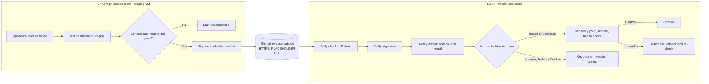
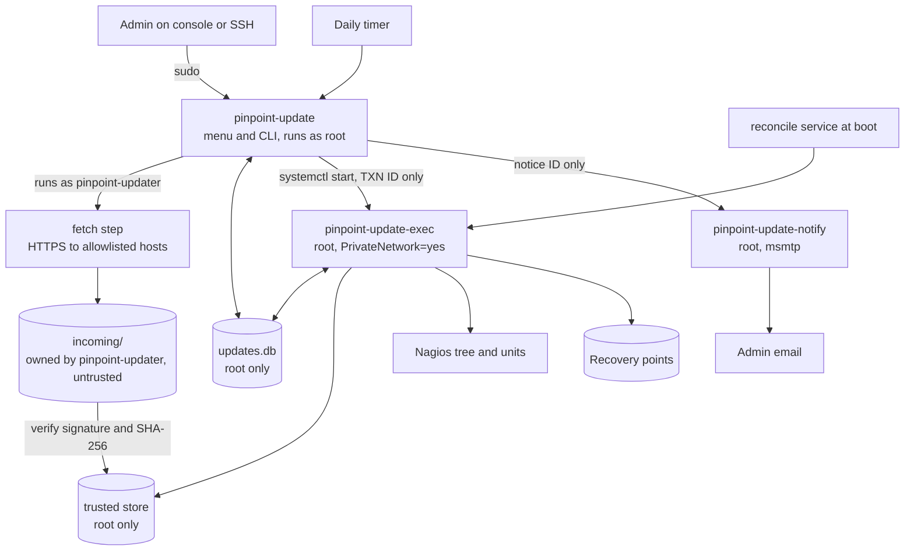
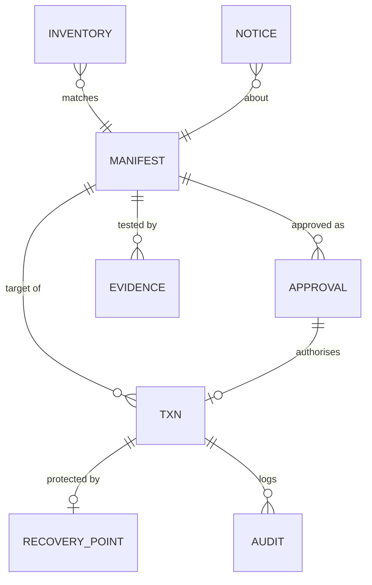
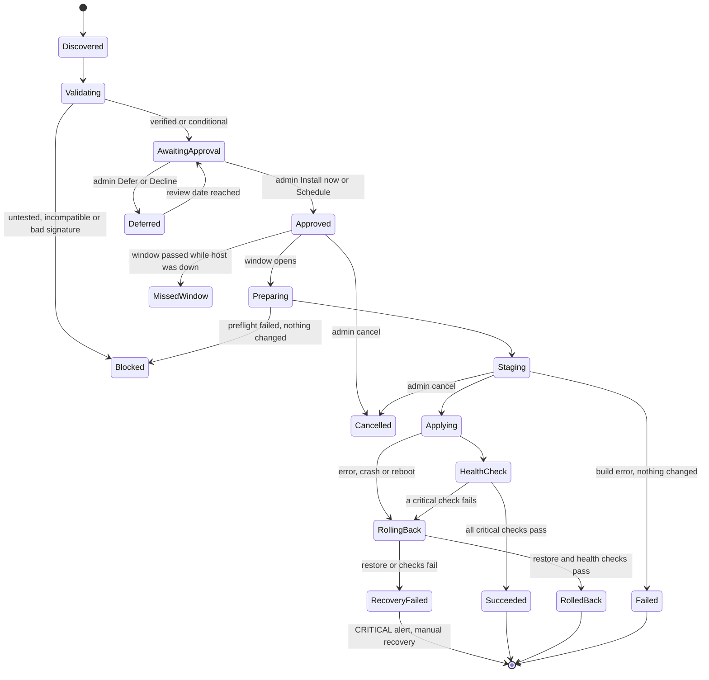
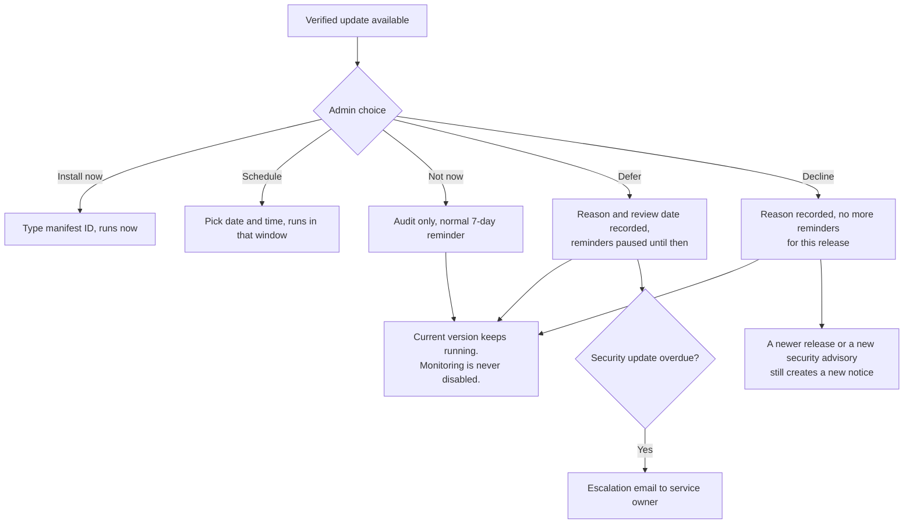
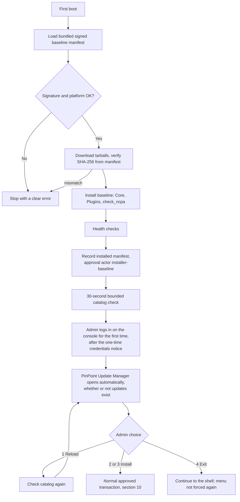
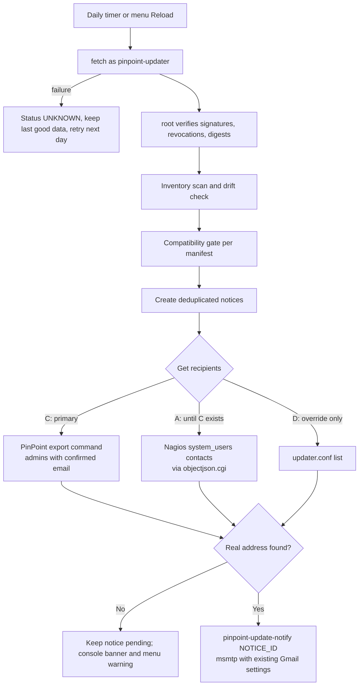
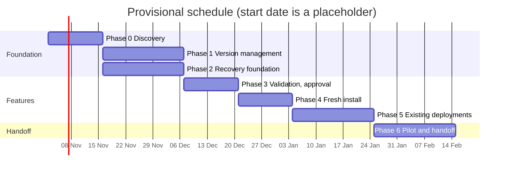

# University handoff: Nagios update management and maintenance plan

Draft date: 27 October 2026. Status: **proposed design**. Nothing in this document is implemented
yet, and university acceptance is pending. It replaces the 26 October draft of this file.

How to read this document:

- Statements about the current installer cite the file and line, for example
  `setup/install-nagios-core.sh:49`. These are facts about this repository.
- **Assumption** marks something believed but not verified.
- `<PLACEHOLDER>` marks a value that does not exist yet and must be chosen. Do not copy a placeholder
  into production.
- Program names, paths and identifiers for new parts (`pinpoint-update`, `updates.db`, and so on) are
  proposed names. They do not exist until the matching phase is built.

---

## 1. Executive summary

Each PinPoint appliance builds Nagios Core **4.5.11** and Nagios Plugins **2.4.12** from upstream
source during first boot, and downloads an **unpinned** `check_ncpa.py`. Downloads are not checked
against any checksum or signature. No record of the installed versions is written. Nagios and the
plugins have no upgrade or rollback path; only the PinPoint web app has one
(`setup/deploy-pinpoint-web.sh:283-346`).

This plan adds a controlled update lifecycle:

1. The university release team tests each candidate combination on a staging VM, then signs and
   publishes a **manifest**. A manifest lists exact versions and SHA-256 digests.
2. Each appliance checks the signed catalog daily. It tells the admin by console and email.
3. Nothing installs until an admin approves that exact manifest in the **PinPoint Update Manager**, a
   numbered console menu.
4. Before changing anything, the updater takes a verified **recovery point**. If any critical health
   check fails, it **rolls back automatically** and checks the old version again.
5. Admins may refuse an update. Monitoring keeps running on the installed version.



**Key rule: a newer release is not an installable release.** Only a manifest that the university team
has tested and signed can be installed through the normal path.

---

## 2. Requirements, facts and assumptions

### 2.1 Requirements (from the handoff brief and discussion)

| ID | Requirement |
|---|---|
| R1 | Support fresh installations and existing appliances. |
| R2 | Every update needs explicit approval by an authorised admin, bound to an exact manifest and host. |
| R3 | Automatic rollback on failure, verified by health checks. |
| R4 | Approved combinations are recorded in signed, immutable, version-controlled manifests. |
| R5 | Updates are never forced. An admin may defer or decline; monitoring continues. |
| R6 | Admin interface is a **command-line console menu** only (decision of 27 Oct 2026). |
| R7 | Update notices for existing appliances go to the **real admin email held by PinPoint**. |
| R8 | Every approval, refusal, change, failure and recovery is audited. |
| R9 | A few independent appliances share one catalog; no central fleet controller. |
| R10 | The receiving university team can run an update and a restore with the runbooks alone. |

Decisions carried over from the 26 October handoff discussion:

- Compatibility testing and release approval are shared by the original development team and
  university IT during the transition. Developers prepare evidence; university IT validates staging and
  authorises production changes. Primary and backup people, a transition end date and the university
  successor must be named before acceptance (§18).
- The deployed system operates online. A future offline installer is a separate milestone (§3).
- Notices reuse the configured alert email transport (Gmail and its app password, when selected). No
  second app password is needed.
- No forced-update policy has been authorised.

### 2.2 Verified facts about the current installer

| Area | Fact | Source |
|---|---|---|
| Platform | Ubuntu Server 22.04.5 LTS, x86_64 only; no runtime OS check | `README.md:10`, `scripts/build.sh:91-100` |
| Topology | One host runs Nagios, Apache, Gunicorn/Flask, Nginx and snmpd | `README.md:26-81` |
| Nagios Core | Source build of 4.5.11; version is a literal in the script | `setup/install-nagios-core.sh:48-64` |
| Plugins | Source build of 2.4.12 | `setup/install-nagios-plugins.sh:15-18` |
| check_ncpa | Fetched fresh, "not pinned", every run | `setup/install-nagios-plugins.sh:22, 127-129` |
| Verification | No checksum or signature check on any download | (absence across `setup/`) |
| Fresh-only config step | `configure-nagios.sh` enters `/usr/local/src/nagios-4.5.11` and runs `make install-config` | `setup/configure-nagios.sh:74-76` |
| Nagios location | Source default prefix `/usr/local/nagios` (bin, sbin, share, etc, var, libexec) | `setup/install-nagios-core.sh:75-114` |
| Apache | Nagios web on `127.0.0.1:8081` only | `setup/configure-nagios.sh:144-149` |
| PinPoint reads Nagios | `statusjson`/`objectjson`/`archivejson` CGIs with the read-only `pinpoint-api` account | `setup/configure-nagios.sh:217-233`, `docs/Network-Diagnosis-System-Installer-Integration.md` |
| PinPoint writes Nagios | `hosts.cfg`, `plugin-services.cfg` (`pinpoint:nagios 664`), then `nagios -v` and `sudo systemctl reload nagios` | `setup/configure-pinpoint-privileges.sh:268-326` |
| PinPoint restarts Nagios | The app may run `systemctl restart nagios` | `setup/configure-pinpoint-privileges.sh:70-75` |
| Resource secrets | NCPA tokens in `resource.cfg` through the root helper | `setup/install-resource-helper.sh`, `docs/Resource-Secrets.md` |
| Event handler | Spool `/usr/local/nagios/var/spool/pinpoint-events` | `setup/configure-event-handler.sh:90-130` |
| Mail | `notify-*-by-email` via `/bin/mail`, msmtp, `/etc/msmtprc` (`root:nagios 640`) written only by a root helper | `setup/configure-pinpoint-privileges.sh:377-592` |
| Admin emails in Nagios | PinPoint writes a `define contact` per user and a `system_users` contact group | `tests/smtp-admin-email-tests-Result.md:348-355` |
| Known app bug | Editing a user does not regenerate `hosts.cfg`, so contacts can be stale | `tests/smtp-admin-email-tests-Result.md:357-363` |
| App data | SQLite `system.db` and `history.db`, Alembic migrations, owned by the app deploy script | `setup/deploy-pinpoint-web.sh:176-228` |
| App version | `git clone` of `main`, unpinned | `setup/deploy-pinpoint-web.sh:45-46` |
| Existing rollback | App upgrade backs up to `/var/backups/pinpoint/<ts>/` and rolls back from an EXIT trap | `setup/deploy-pinpoint-web.sh:283-346, 509-532` |
| Console login hook | `/etc/profile.d/pinpoint-login-hook.sh` shows install credentials once | `setup/pinpoint-login-hook.sh`, `autoinstall/user-data:39-40` |
| Health check | Read-only `pinpoint-healthcheck.sh`; exit code is the number of failed checks | `setup/pinpoint-healthcheck.sh:1-30` |
| Tests | Bash VM runners reporting `ID|STATUS|note`; Python `unittest`; no CI | `tests/` |
| Hardware minimum | 2 cores, 4 GB RAM, 40 GB disk | `docs/Deployment-Guide.md:21` |

### 2.3 Assumptions and their effect

| ID | Assumption | If wrong |
|---|---|---|
| A1 | `/usr/local/nagios` stays well under 1 GB, so a full copy is a cheap recovery point. | Recovery point moves to a tar archive on another disk; cutover time grows. |
| A2 | Nagios upgrades within 4.x do not change object-config syntax PinPoint generates. | That candidate is classed "config migration" (§11.3) and needs extra qualification. |
| A3 | The PinPoint app can be pinned to a tag or commit per manifest. | Manifests cannot bind to a PinPoint version; compatibility claims weaken. This is a blocker (§19, B6). |
| A4 | Upstream tarball URLs stay reachable, or the university mirrors them. | Mirror becomes mandatory (§12). |
| A5 | Stopping the PinPoint web app during cutover (minutes) is acceptable inside a maintenance window. | Need a config-write freeze inside the app instead (app change). |
| A6 | The first console user created by the autoinstaller is a member of `sudo` and is a legitimate admin. | First-install admin group membership must be set by hand. |

---

## 3. Scope and non-goals

**In scope:** Nagios Core, official Nagios Plugins, and `check_ncpa.py` on PinPoint appliances; fresh
installs and existing appliances; console menu and CLI; email notices; recovery; tests; runbooks.

**Not in scope (future work or other owners):**

| Item | Why / where it goes |
|---|---|
| PinPoint web app updates | Already handled by `deploy-pinpoint-web.sh`; this updater only shares its lock. |
| Ubuntu release upgrades (22.04 → newer) | Separate OS-migration project; see risk K1. |
| apt security updates | Handled by Ubuntu `updates: security` and normal OS patching. |
| NCPA agents on monitored hosts | Deployed by the app; only the server-side `check_ncpa.py` is managed here. |
| Web UI for updates | Excluded by decision R6. The `--json` CLI output (§8.4) lets one be added later. |
| PinPoint maintenance-window page integration | Was proposed in the 26 Oct draft; deferred with the web UI. |
| Central fleet controller | Excluded by decision R9. |
| Offline installer | Separate milestone: bundle approved artifacts, OS packages, app dependencies and manifest; test with networking disabled. Offline appliances would import signed bundles through the same gates. |
| Automatic installation without a per-update approval | Not authorised. Would need a separate university decision and its own tests. |

---

## 4. Architecture and component responsibilities

### 4.1 Components



### 4.2 Responsibilities

| Component | Runs as | Does | Never does |
|---|---|---|---|
| `pinpoint-update` (controller, menu, CLI) | root through sudo; checks the caller's role itself | Menu, discovery scheduling, verify signatures and digests, compatibility gate, approvals, scheduling, notices, audit, history | Install files; run downloaded code; accept URLs or paths from the user |
| fetch step (`pinpoint-update fetch`) | `pinpoint-updater` (unprivileged) | Download catalog, signatures and tarballs over HTTPS into `incoming/` | Write to the trusted store or database |
| `pinpoint-update-exec` (privileged executor) | root, only as a systemd unit, `PrivateNetwork=yes` | Preflight, recovery point, build (dropping to `pinpoint-updater`), cutover, health checks, rollback, reconcile | Use the network; accept anything except a transaction ID |
| `pinpoint-update-reconcile.service` | root, at boot, before `nagios.service` | Finish any interrupted transaction, always toward the previous version | Retry a forward update |
| `pinpoint-update-notify` | root through one exact sudoers rule | Render a stored notice and send it with msmtp | Read arguments other than a notice ID; print the SMTP password |
| Health suite (`pinpoint-update-health`) | root | Versioned critical and warning checks (§13.1) | Change the system |

**Why the controller writes as root:** approval rows decide what root installs. If the network-facing
user could write them, a compromised download step could forge an approval. So everything that
downloads is unprivileged and untrusted, and everything that decides is root-only and checks
signatures before trusting any downloaded file.

### 4.3 Source layout in this repository (proposed)

| Path | Purpose |
|---|---|
| `setup/pinpoint-update.py` | Controller, menu and CLI (Python 3 standard library only) |
| `setup/pinpoint-update-exec.py` | Privileged executor and reconcile |
| `setup/pinpoint-update-health.sh` | Versioned health suite; reuses `pinpoint-healthcheck.sh` |
| `setup/configure-monitoring-updates.sh` | Installs users, groups, units, timers, sudoers, keyring, baseline manifest |
| `setup/manifests/` | Bundled baseline manifest, signature and trusted keyring |
| `tests/test_pinpoint_update.py` | Unit tests |
| `tests/update-*-tests.sh` | VM runners |
| `docs/Monitoring-Updates-Runbook.md` | Operations runbook (§18) |

Python 3 from Ubuntu (`/usr/bin/python3`, 3.10 on 22.04) is used, not the app's uv-managed 3.14, so the
updater keeps working if the app's environment is broken. No pip packages: SQLite, JSON, hashing,
HTTPS and subprocess are in the standard library; signatures use `gpgv`.

---

## 5. Linux deployment model

| Item | Value | Owner and mode |
|---|---|---|
| System user | `pinpoint-updater` (nologin, no home shell) | — |
| Admin group | `pinpoint-update-admins` | may approve, schedule, defer, decline, cancel, recover |
| Viewer group | `pinpoint-update-viewers` | may read status, list, show, history, audit |
| Config | `/etc/pinpoint/updates/updater.conf` | `root:root 644` (no secrets) |
| Trusted keyring | `/etc/pinpoint/updates/trusted-keys.gpg` | `root:root 644` |
| Database | `/var/lib/pinpoint/updates/updates.db` | `root:root 600` (WAL files likewise) |
| Untrusted downloads | `/var/lib/pinpoint/updates/incoming/` | `pinpoint-updater:pinpoint-updater 700` |
| Trusted store | `/var/lib/pinpoint/updates/store/<sha256>` | `root:root 700` |
| Build area | `/var/lib/pinpoint/updates/build/<txn>/` | `pinpoint-updater 700` while building |
| Recovery points | `/usr/local/.pinpoint-rp/<rp-id>/` (same filesystem as `/usr/local/nagios`) | `root:root 700` |
| Lock | `/run/lock/pinpoint-update.lock` (`flock`) | shared with `deploy-pinpoint-web.sh` |
| Log | `/var/log/pinpoint-update.log` | added to `/etc/logrotate.d/pinpoint` |
| First-menu marker | `/var/lib/pinpoint/updates/first-menu-shown` | `root:root 644` |
| Sudoers | `/etc/sudoers.d/pinpoint-update` | `root:root 440`, validated with `visudo -cf` |

systemd units (all proposed):

| Unit | Type | Purpose |
|---|---|---|
| `pinpoint-update-check.timer` / `.service` | daily, `RandomizedDelaySec=1h` | Discovery and notices |
| `pinpoint-update-exec@<txn>.service` | oneshot, `PrivateNetwork=yes` | Runs one transaction |
| `pinpoint-update-run.timer` | every 5 minutes | Starts approved transactions whose window has opened |
| `pinpoint-update-reconcile.service` | oneshot, `Before=nagios.service pinpoint-gunicorn.service` | Reconcile after reboot |

Sudoers (proposed, exact paths, no wildcards in the command path):

```text
%pinpoint-update-admins  ALL=(root) NOPASSWD: /usr/local/sbin/pinpoint-update, /usr/local/sbin/pinpoint-update *
%pinpoint-update-viewers ALL=(root) NOPASSWD: /usr/local/sbin/pinpoint-update, /usr/local/sbin/pinpoint-update *
```

Sudo only gets the caller into the program. **The program decides what each role may do** by reading
`SUDO_USER` and that user's groups (§8.2). A viewer who types `approve` is refused by the program and
the refusal is audited.

Who becomes an admin on a fresh install: `configure-monitoring-updates.sh` adds the members of the
`sudo` group at install time to `pinpoint-update-admins` (assumption A6). University IT adds or
removes people later with `usermod`, which is recorded in the runbook.

---

## 6. Data models

### 6.1 Release manifest (signed JSON, immutable)

A manifest describes one **combination**. Changing anything means publishing a new manifest ID.
Manifests contain no secrets.

```json
{
  "schema_version": 1,
  "manifest_id": "pp-mon-2026.11-1",
  "published_at": "2026-11-15T10:00:00Z",
  "publisher": "<PLACEHOLDER university release team>",
  "pinpoint": { "repo": "esfen14/Network-Diagnosis-System", "ref": "<PLACEHOLDER tag or commit>" },
  "platform": { "os": "ubuntu", "version": "22.04", "arch": "x86_64" },
  "components": {
    "nagios-core": {
      "version": "4.5.11",
      "artifact": {
        "url": "https://assets.nagios.com/downloads/nagioscore/releases/nagios-4.5.11.tar.gz",
        "sha256": "<PLACEHOLDER 64 hex>"
      },
      "build_profile": "core-source-v1"
    },
    "nagios-plugins": {
      "version": "2.4.12",
      "artifact": {
        "url": "https://nagios-plugins.org/download/nagios-plugins-2.4.12.tar.gz",
        "sha256": "<PLACEHOLDER 64 hex>"
      },
      "build_profile": "plugins-source-v1"
    },
    "check-ncpa": {
      "version": "<PLACEHOLDER upstream version or 'digest-only'>",
      "artifact": { "url": "<PLACEHOLDER pinned URL or mirror>", "sha256": "<PLACEHOLDER 64 hex>" },
      "build_profile": "ncpa-client-v1"
    }
  },
  "dependencies": { "apt": ["build-essential", "libssl-dev", "unzip"] },
  "upgrade_from": ["pp-mon-baseline-1"],
  "migration_class": "binary-only",
  "compatibility": {
    "state": "verified",
    "evidence_ids": ["ev-2026-11-14-staging-01"],
    "known_limitations": []
  },
  "security": { "advisories": [], "priority": "normal" },
  "expected_downtime_minutes": 10,
  "release_notes_url": "<PLACEHOLDER>",
  "support_until": "<PLACEHOLDER date>"
}
```

Rules:

- The signature is a detached `manifest.json.sig` made by a key in the appliance keyring.
- `build_profile` names a build recipe **shipped in the updater code**. Manifests never contain
  commands, so a manifest cannot run anything.
- `url` hosts must be on the allowlist in `updater.conf`. The SHA-256 in the signed manifest is what
  makes the file trusted; the URL only says where to fetch it.
- `compatibility.state` is one of `verified`, `conditional`, `untested`, `incompatible`, `deprecated`.
  Only `verified` and `conditional` can be installed. `conditional` shows its limitations and needs an
  extra confirmation.
- Revocations are published in a signed `revoked.json` (manifest IDs and key fingerprints). A revoked
  manifest becomes `deprecated` locally and any pending approval for it is voided.

The catalog is a university-owned Git repository (`<PLACEHOLDER URL>`) published over HTTPS:

```text
catalog/
  index.json            # list of manifest IDs and digests, signed
  index.json.sig
  revoked.json          # signed revocations
  revoked.json.sig
  manifests/<id>.json
  manifests/<id>.json.sig
  evidence/<evidence-id>.md   # human-readable test report
```

### 6.2 Local database (SQLite, root only)



```sql
-- Proposed schema v1. PRAGMA journal_mode=WAL; PRAGMA foreign_keys=ON.
CREATE TABLE manifest (
  manifest_id     TEXT PRIMARY KEY,
  schema_version  INTEGER NOT NULL,
  sha256          TEXT NOT NULL UNIQUE,      -- digest of the exact signed bytes
  signer_fpr      TEXT NOT NULL,             -- key fingerprint that signed it
  compat_state    TEXT NOT NULL CHECK (compat_state IN
                  ('verified','conditional','untested','incompatible','deprecated')),
  source          TEXT NOT NULL CHECK (source IN ('bundled','catalog')),
  body_json       TEXT NOT NULL,
  first_seen_at   TEXT NOT NULL
);

CREATE TABLE inventory (                     -- one row per component per scan
  scan_id         TEXT NOT NULL,
  host_id         TEXT NOT NULL,             -- /etc/machine-id
  component       TEXT NOT NULL,             -- nagios-core, nagios-plugins, check-ncpa, pinpoint, os
  installed_version TEXT,
  managed         INTEGER NOT NULL,          -- 1 = updater may change it
  artifact_sha256 TEXT,
  config_fingerprint TEXT,                   -- hash of nagios.cfg, cgi.cfg, resource.cfg structure (not secrets)
  scanned_at      TEXT NOT NULL,
  PRIMARY KEY (scan_id, component)
);

CREATE TABLE installed_state (               -- the single current answer
  host_id         TEXT PRIMARY KEY,
  manifest_id     TEXT NOT NULL REFERENCES manifest,
  since           TEXT NOT NULL,
  last_txn_id     TEXT
);

CREATE TABLE approval (
  approval_id     TEXT PRIMARY KEY,
  manifest_id     TEXT NOT NULL REFERENCES manifest,
  manifest_sha256 TEXT NOT NULL,             -- binds to exact bytes
  host_id         TEXT NOT NULL,             -- scope: this appliance
  source_manifest_id TEXT NOT NULL,          -- approved FROM this state only
  approver        TEXT NOT NULL,             -- SUDO_USER, or 'installer-baseline'
  decision        TEXT NOT NULL CHECK (decision IN ('approve','defer','decline')),
  reason          TEXT,
  window_start    TEXT, window_end TEXT,     -- NULL = install now
  review_date     TEXT,                      -- for defer
  created_at      TEXT NOT NULL,
  expires_at      TEXT,
  status          TEXT NOT NULL CHECK (status IN ('active','used','expired','revoked','superseded'))
);

CREATE TABLE txn (
  txn_id          TEXT PRIMARY KEY,
  host_id         TEXT NOT NULL,
  source_manifest_id TEXT NOT NULL,
  target_manifest_id TEXT NOT NULL REFERENCES manifest,
  approval_id     TEXT NOT NULL REFERENCES approval,
  state           TEXT NOT NULL,             -- §7
  step            TEXT,                      -- last completed sub-step, for reconcile
  recovery_point_id TEXT REFERENCES recovery_point,
  failure_code    TEXT,
  recovery_status TEXT,
  created_at TEXT NOT NULL, started_at TEXT, finished_at TEXT,
  downtime_seconds INTEGER
);
CREATE UNIQUE INDEX one_active_txn ON txn(host_id)
  WHERE state NOT IN ('succeeded','rolled_back','failed','recovery_failed','cancelled','missed_window','blocked');

CREATE TABLE recovery_point (
  rp_id           TEXT PRIMARY KEY,
  txn_id          TEXT NOT NULL,
  kind            TEXT NOT NULL,             -- 'tree-copy-v1'
  location        TEXT NOT NULL,             -- fixed under /usr/local/.pinpoint-rp/
  file_manifest_sha256 TEXT NOT NULL,        -- hash of the per-file hash list
  size_bytes      INTEGER NOT NULL,
  created_at      TEXT NOT NULL,
  verified_at     TEXT,
  restore_tested  TEXT,                      -- date of last restore drill on this kind
  retain_until    TEXT
);

CREATE TABLE evidence (
  evidence_id     TEXT PRIMARY KEY,
  manifest_id     TEXT NOT NULL,
  pinpoint_ref    TEXT NOT NULL,
  os_profile      TEXT NOT NULL,
  suite_version   TEXT NOT NULL,
  result          TEXT NOT NULL,             -- pass / pass-with-exceptions / fail
  tested_at       TEXT NOT NULL,
  limitations     TEXT,
  authority       TEXT NOT NULL              -- who signed off
);

CREATE TABLE notice (
  notice_id       TEXT PRIMARY KEY,
  kind            TEXT NOT NULL,             -- §14
  manifest_id     TEXT,
  dedupe_key      TEXT NOT NULL UNIQUE,
  body_json       TEXT NOT NULL,
  created_at      TEXT NOT NULL,
  sent_at         TEXT, attempts INTEGER NOT NULL DEFAULT 0, next_attempt_at TEXT
);

CREATE TABLE audit (                         -- append-only, hash-chained
  seq             INTEGER PRIMARY KEY AUTOINCREMENT,
  at              TEXT NOT NULL,
  actor           TEXT NOT NULL,             -- user, 'timer', 'executor', 'reconcile'
  event           TEXT NOT NULL,
  txn_id          TEXT, manifest_id TEXT,
  detail_json     TEXT NOT NULL,             -- never contains secrets
  prev_hash       TEXT NOT NULL,
  hash            TEXT NOT NULL              -- sha256(prev_hash || canonical row)
);
```

A plain JSON file is not used as the authoritative store: SQLite gives transactions, the unique
"one active transaction" index and crash safety. Audit rows are also copied to
`/var/log/pinpoint-update.log` and the journal, so deleting the database cannot erase history silently.

---

## 7. Update state machine



`Failed` is used for a transaction that stopped in Staging, before any active file was touched (for
example, a build error). Nothing needs restoring, so it does not pass through RollingBack.

### 7.1 Transition rules

| From | To | Who | Condition |
|---|---|---|---|
| AwaitingApproval | Approved | admin | Role check; typed manifest ID matches; manifest still valid; source state matches `approval.source_manifest_id` |
| Approved | Preparing | run timer or "Install now" | Window open; enough window time left for update **plus** rollback |
| Approved / Staging | Cancelled | admin | Only before Applying |
| Preparing | Staging | executor | All preflight checks pass (§10, step 9) |
| Staging | Applying | executor | Artifacts built; recovery point verified; lock held |
| Applying | HealthCheck | executor | Install steps finished |
| any active | RollingBack | executor or reconcile | Error, health failure, or unfinished Applying found at boot |
| RollingBack | RolledBack | executor | Restored tree verified **and** critical health checks pass on old version |
| RollingBack | RecoveryFailed | executor | Any restore step or critical health check fails |

**Invalid transitions** are refused by one function, `transition(txn, to_state)`, which checks this
table inside a database transaction, writes the audit row in the same commit, and returns exit code 6.

**Approval invalidation.** An approval becomes `expired`, `revoked` or `superseded` when: it passes
`expires_at` (default `<PLACEHOLDER 14 days>`); the manifest is revoked; the installed state no longer
matches `source_manifest_id`; the host ID or platform changes; or a different manifest is approved.

**Locking.** The executor holds `flock` on `/run/lock/pinpoint-update.lock` from Preparing to the final
state. `deploy-pinpoint-web.sh` takes the same lock, so an app upgrade and a Nagios update can never run
together. The unique index in §6.2 is a second guard.

### 7.2 Reconcile after crash or reboot

```text
on boot (before nagios.service):
  txn = active transaction for this host, if any
  if txn is None: exit
  if txn.state in (Approved, Preparing, Staging):
      # active installation was not touched
      clean build area; mark Failed (or back to Approved if the window is still open and
      the approval is still valid); notify
  if txn.state in (Applying, HealthCheck, RollingBack):
      # cannot trust a half-applied tree: never retry forward
      if recovery point verifies:
          restore it (idempotent rename swap, §11.2); run critical health checks
          mark RolledBack or RecoveryFailed
      else:
          mark RecoveryFailed; keep everything; CRITICAL notice
  if txn.state is Approved and its window has passed: mark MissedWindow; notify
```

Every restore step is written so that running it twice gives the same result. Each sub-step is
recorded in `txn.step` before and after it runs.

---

## 8. Admin menu, CLI and contract

### 8.1 PinPoint Update Manager (console menu)

`sudo pinpoint-update` with no arguments opens the menu.

**Main screen** (example with one verified update):

```text
 ================================================================
  PinPoint Update Manager                     host: <HOSTNAME>
  Ubuntu 22.04 x86_64          catalog checked: 2026-10-27 09:12
 ----------------------------------------------------------------
  Component          Installed     Available      Status
  Nagios Core        4.5.11        <X.Y.Z>        VERIFIED
  Nagios Plugins     2.4.12        <X.Y.Z>        UNTESTED
  check_ncpa         <sha:1a2b..>  -              up to date
 ----------------------------------------------------------------
  Recovery ready: YES (12 GB free)   Last update: none
  Notices go to: admin@<university> (from PinPoint)
 ================================================================

   1) Reload (check for updates)
   2) Install updates
   3) Choose what to update
   4) Exit

  Enter an option:
```

| Option | What happens |
|---|---|
| 1) Reload | Fetch the catalog, verify signatures, redraw. If unreachable, the status line says `Update status UNKNOWN (last good check: ...)`, never "up to date". |
| 2) Install updates | Offer the newest **verified** manifest whose `upgrade_from` includes the installed manifest. |
| 3) Choose what to update | Tick components; continue only if a verified manifest matches that exact combination. |
| 4) Exit | Change nothing. |

History, status and recovery are subcommands (`status`, `history`, `recover`), keeping the menu at the
four options agreed.

**Decision screen** (after 2 or 3):

```text
  Update set: <MANIFEST-ID>   (digest 9f3c..e1)
  Nagios Core 4.5.11 -> <X.Y.Z>   VERIFIED (evidence: <EVIDENCE-ID>)
  Security fixes: yes (<ADVISORY-ID>)
  Expected downtime: ~<N> min   Rollback: automatic
  Release notes: <URL>

   1) Install now
   2) Schedule for later
   3) Not now (ask me again later)
   4) Defer (give a reason and a review date)
   5) Decline this release
   6) Back
```

"Install now" and "Schedule" ask the admin to type the manifest ID to confirm. A `conditional`
manifest shows its limitations and asks a second time.

**Choose what to update** (option 3):

```text
  Select components (toggle with number, C to continue):
   [x] 1) Nagios Core     4.5.11 -> <X.Y.Z>
   [ ] 2) Nagios Plugins  2.4.12 -> <X.Y.Z>
   [ ] 3) check_ncpa      unchanged

  Matching verified update set: <MANIFEST-ID>  -> OK to continue
```

If no verified manifest matches the ticked set, the screen says *"This combination is not verified
and cannot be installed. Choose another set or wait for the university team."* and C is disabled.

**Progress screen:**

```text
  Updating <MANIFEST-ID>  (do not power off)
   [OK] Preflight checks
   [OK] Recovery point created and verified
   [OK] Artifacts verified (SHA-256 and signature)
   [OK] Candidate built (monitoring still running)
   [..] Applying (PinPoint web and Nagios stopped)
   [  ] Health checks
  Ctrl-C is ignored from "Applying" on; rollback is automatic on failure.
```

The work runs in `pinpoint-update-exec@<txn>.service`, not in the menu process. Closing the SSH session
does not stop it; `sudo pinpoint-update status` reattaches to the progress view.

### 8.2 When the admin does not want to update



- Nothing is forced. PinPoint keeps working on the installed version indefinitely.
- Every refusal is audited with the user, time and reason.
- Security updates keep reminding and escalate to the service owner after `<PLACEHOLDER 30 days>`. They
  never skip testing or approval. An emergency-change process is a separate university decision (§12.3).

### 8.3 Roles

| Command | Viewer | Admin |
|---|---|---|
| menu (read-only parts), `status`, `list`, `show`, `history`, `audit`, `inventory` | yes | yes |
| `discover` (Reload) | yes | yes |
| `approve`, `schedule`, `defer`, `decline`, `cancel`, `recover` | **no** | yes |

The program reads `SUDO_USER` and its groups. A direct root login is allowed for emergencies and is
recorded as actor `root` with a warning in the audit row.

### 8.4 CLI commands

There is no network API. The CLI is the contract; every command accepts `--json` and then prints one
JSON object (schema `pinpoint-update/v1`) so a future web UI can call it without duplicating rules.

| Command | Arguments (validated) | Role | Effect / transition | Idempotent | Audit event |
|---|---|---|---|---|---|
| `inventory` | — | viewer | New inventory scan | yes | `inventory.scanned` |
| `discover` | `--timeout SECONDS` (1–120) | viewer | Fetch and verify catalog; create notices | yes | `catalog.checked` / `catalog.failed` |
| `list` | `--all` | viewer | Show manifests and states for this host | yes | — |
| `show` | `MANIFEST_ID` (`^[a-z0-9.-]{1,64}$`) | viewer | Manifest, evidence, notes | yes | — |
| `validate` | `MANIFEST_ID` | viewer | Run the compatibility gate only | yes | `manifest.validated` |
| `approve` | `MANIFEST_ID --confirm MANIFEST_ID [--at ISO8601 --window-minutes N]` | admin | AwaitingApproval → Approved; creates txn | same ID twice → returns existing approval | `approval.created` |
| `defer` | `MANIFEST_ID --reason TEXT --review-date DATE` | admin | → Deferred | yes | `approval.deferred` |
| `decline` | `MANIFEST_ID --reason TEXT` | admin | → Deferred (declined) | yes | `approval.declined` |
| `cancel` | `TXN_ID` | admin | Approved/Staging → Cancelled | yes | `txn.cancelled` |
| `status` | `[TXN_ID] [--follow]` | viewer | Show current or given transaction | yes | — |
| `history` | `[--limit N]` | viewer | Past transactions | yes | — |
| `recover` | `--to-recovery-point RP_ID --confirm RP_ID` | admin | Authorised manual restore (only from RecoveryFailed or when no txn is active) | yes | `recovery.requested` |
| `audit` | `[--since DATE] [--verify]` | viewer | Print audit; `--verify` checks the hash chain | yes | — |

Free-text fields (`--reason`) are limited to 500 printable characters and are stored, never executed
or passed to a shell. No command accepts a URL, a path or a shell fragment.

### 8.5 Exit codes and errors

| Code | Name | Example |
|---|---|---|
| 0 | OK | — |
| 2 | INVALID_INPUT | Bad manifest ID format, confirmation mismatch |
| 3 | NOT_AUTHORISED | Viewer tried `approve` |
| 4 | BLOCKED | Untested, incompatible, revoked, bad signature, wrong platform |
| 5 | BUSY | Another transaction or `deploy-pinpoint-web.sh` holds the lock |
| 6 | INVALID_TRANSITION | Cancel requested during Applying |
| 7 | CATALOG_UNAVAILABLE | Network or TLS failure; nothing changed |
| 8 | PREFLIGHT_FAILED | Disk space, recovery point, dependency check |
| 10 | ROLLED_BACK | Update failed, previous version restored and healthy |
| 11 | RECOVERY_FAILED | Restore or post-restore checks failed; manual action needed |

---

## 9. Fresh-install workflow



Steps and where they change existing code:

1. **Bundled baseline.** The ISO carries `setup/manifests/pp-mon-baseline-1.json`, its `.sig` and the
   keyring. `scripts/build.sh` copies them (it currently copies only scripts, `scripts/build.sh:31-43`).
2. **Verify before install.** `install-nagios-core.sh` and `install-nagios-plugins.sh` read version, URL
   and SHA-256 from the verified manifest instead of the literals at
   `setup/install-nagios-core.sh:48-64` and `setup/install-nagios-plugins.sh:15-22`. A mismatch stops
   the install. `check_ncpa.py` is pinned by digest (replacing `:127-129`).
3. **Source path.** `configure-nagios.sh:74` uses the resolved source directory, not the literal.
4. **Record.** First boot writes the inventory and `installed_state`, with the approval actor
   `installer-baseline` (running the installer is the approval of the bundled baseline).
5. **Discover.** A bounded check (30 seconds total) runs before first boot prints its completion
   message. Failure never blocks the install.
6. **Menu once.** `setup/pinpoint-login-hook.sh` gains a second step: after the credentials notice,
   if `/var/lib/pinpoint/updates/first-menu-shown` does not exist, write it and run
   `sudo /usr/local/sbin/pinpoint-update --first-login`. The marker is written when the menu is
   **shown**, so a dropped session cannot make it reappear on every login.
7. **Later logins** show one line: `Updates: none` or `Updates: N verified available - run sudo
   pinpoint-update`.
8. **No email at first install.** The admin's real address exists only after PinPoint's web setup, so
   the console is the only notice here.

**No updates available:**

```text
 ================================================================
  PinPoint Update Manager                     host: <HOSTNAME>
  Fresh install complete          catalog checked: <DATE TIME>
 ----------------------------------------------------------------
  Component          Installed     Available      Status
  Nagios Core        4.5.11        -              up to date
  Nagios Plugins     2.4.12        -              up to date
  check_ncpa         <sha:1a2b..>  -              up to date
 ----------------------------------------------------------------
  No updates available. Your installation is ready.
 ================================================================

   1) Reload (check for updates)
   2) Install updates            (nothing to install)
   3) Choose what to update      (nothing to install)
   4) Exit
```

If the catalog cannot be reached, the status line says `Update status UNKNOWN (catalog unreachable)`.
Exit still works and the install is still complete. **First boot never upgrades past the baseline.**

If the bundled baseline cannot be verified (bad signature, wrong platform), the install stops before
building Nagios and prints why. It never falls back to unverified downloads.

---

## 10. Existing-deployment workflow

### 10.1 Discovery and notices



**Drift detection.** The scan compares `nagios -V`, plugin file hashes and the `check_ncpa.py` hash
with the installed manifest. A mismatch means someone changed Nagios outside the updater: the notice
says so, and new approvals are refused (BLOCKED) until an admin investigates and records the state.

**Where the admin email comes from.** The real admin email lives in the PinPoint web app. The updater
asks PinPoint and keeps no copy of its own.

| Source | Role | Notes |
|---|---|---|
| **C. App export command** | Primary, once added | New backend command in the app repo, for example `flask export-update-recipients --json`: users with the admin role and a confirmed email. Run as `pinpoint` through one exact sudoers rule. The only source that knows who is an admin. |
| **A. Nagios `system_users` contacts** | Until C exists | Works today (`tests/smtp-admin-email-tests-Result.md:348-355`). Includes all users, not just admins, and can be stale because of the known app bug (`:357-363`), which should be fixed in the app repo. Read through `objectjson.cgi` with the existing read-only `pinpoint-api` account. |
| **D. `updater.conf` list** | Override or emergency | Shown as `(manual override)` in the menu. |
| B. Reading the app database directly | **Rejected** | Depends on app tables that change with app updates. |

Placeholder addresses (`example.com`, as created by `init-production`) are never used.

**Who holds the Gmail password.** `/etc/msmtprc` is `root:nagios 640`. `pinpoint-updater` is not added
to the `nagios` group, because that group can write Nagios config. The root helper
`pinpoint-update-notify` takes only a notice ID, renders the stored notice and pipes it to msmtp.

**Deduplication.** One notice per manifest and status change; reminders every `<PLACEHOLDER 7 days>`
while unresolved; marked sent only when msmtp accepts it; retries with backoff; a bounded queue.

### 10.2 One update, step by step

```mermaid
sequenceDiagram
    participant A as Admin (menu)
    participant C as Controller (root)
    participant X as Executor (root, no network)
    participant N as Nagios and PinPoint web
    A->>C: 2 Install updates, 1 Install now, types manifest ID
    C->>C: check role, gate, record approval (user, digest, host, source, expiry)
    C->>X: start pinpoint-update-exec@TXN
    X->>X: lock, preflight, re-verify signature, digest and approval
    X->>X: recovery point: copy Nagios tree, unit, Apache conf; verify hashes
    X->>X: build candidate as pinpoint-updater (monitoring still running)
    X->>N: stop pinpoint-gunicorn, then nagios
    X->>N: make install (never install-config), plugins, check_ncpa
    X->>N: nagios -v, start nagios, start pinpoint-gunicorn
    X->>X: health suite
    alt healthy
        X->>C: Succeeded, record downtime, notice "Update successful"
    else unhealthy
        X->>N: stop, swap recovery copy back, restore unit and conf
        X->>X: health suite on the old version
        X->>C: RolledBack, or RecoveryFailed with CRITICAL notice
    end
```

Numbered steps (matching the brief):

1. Daily timer checks the catalog (§10.1).
2. Read installed manifest from `installed_state`.
3. Detect drift and version mismatches.
4. Identify manifests whose `upgrade_from` includes the installed manifest.
5. Notify admins (console banner and email).
6. Menu shows notes, evidence, security relevance and expected downtime.
7. Admin approves the exact manifest ID for this host.
8. Optionally schedule a window; the run timer starts it when the window opens.
9. **Preflight** (nothing is changed yet; any failure → Blocked, exit 8):
   - approval still `active`, not expired, manifest not revoked, signature and digest re-verified;
   - installed state equals `approval.source_manifest_id`; no drift;
   - platform matches; required apt packages are installed (no apt changes during the window);
   - free space ≥ 2 × Nagios tree + build size + `<PLACEHOLDER 1 GB>` margin;
   - the current Nagios config passes `nagios -v` and the baseline health suite passes;
   - window has time for the expected downtime **plus** a rollback.
10. Take the exclusive lock.
11. Create the recovery point and verify every file hash (§11.2).
12. Build the candidate in the build area as `pinpoint-updater`, from tarballs re-verified by SHA-256.
13. Apply: stop `pinpoint-gunicorn` (stops config writes and app-initiated Nagios restarts), stop
    `nagios`, run the `make install` targets for the build profile (**never** `install-config` or
    `install-webconf`), install plugins and `check_ncpa.py`, restore ownership and modes, run `nagios -v`
    with the new binary, start services.
14. Run the critical health suite (§13.1).
15. Commit: update `installed_state`, mark the approval `used`, keep the recovery point until retention.
16. On failure: automatic rollback (§11).
17. Record the result and downtime; notify.

---

## 11. Automatic rollback and persistent state

### 11.1 What must be restored

| Item | Path | Restored on rollback? |
|---|---|---|
| Nagios binaries, CGIs, web files | `/usr/local/nagios/{bin,sbin,share}` | yes |
| Plugins and `check_ncpa.py` | `/usr/local/nagios/libexec` | yes |
| Nagios config (incl. PinPoint-generated files, `resource.cfg`) | `/usr/local/nagios/etc` | yes (frozen during cutover) |
| Retention and status | `/usr/local/nagios/var/retention.dat`, `status.dat` | `retention.dat` yes; state changes during the window are lost (documented) |
| Event spool | `/usr/local/nagios/var/spool/pinpoint-events` | yes; unread events at stop time are preserved in the copy |
| Command pipe, lock and PID files | `/usr/local/nagios/var/rw/`, `nagios.lock` | **not** restored; recreated by Nagios on start |
| Service unit | `nagios.service` (from `make install-daemoninit`) | yes, then `systemctl daemon-reload` |
| Apache site | `/etc/apache2/sites-enabled/nagios.conf` | yes |
| Sudoers and helpers | `/etc/sudoers.d/pinpoint-*`, `/usr/local/sbin/pinpoint-*` | not changed by Nagios updates; hashed and checked only |
| PinPoint databases | `system.db`, `history.db` | not touched by this updater |

### 11.2 Recovery mechanism

**Chosen: same-filesystem tree copy with a rename swap.**

- Create: `cp -a --reflink=auto /usr/local/nagios /usr/local/.pinpoint-rp/<rp-id>/nagios`, plus copies of
  the unit and Apache files, taken **after** services stop for cutover so config and retention are
  consistent. A per-file SHA-256 list (with owner, group, mode) is stored and verified.
- Restore: stop services; `mv /usr/local/nagios /usr/local/.pinpoint-rp/<rp-id>/failed`; `mv` the recovery
  copy back to `/usr/local/nagios`; restore unit and Apache files; `daemon-reload`; verify hashes; start
  services; run the critical health suite.
- Because both paths are under `/usr/local`, `mv` is a rename on one filesystem: fast and atomic.
  Preflight confirms they are on the same filesystem.

The recovery point is created twice: a "warm" copy before building (to prove disk space and speed),
and the authoritative copy after services stop, just before files change.

| Option | Advantages | Disadvantages | Choose when |
|---|---|---|---|
| **Tree copy and rename swap (chosen)** | No LVM or hypervisor needed; small tree; atomic restore; easy to test | Needs 2× disk for the tree; covers only listed paths | Default for all appliances |
| Versioned release directories with a symlink | Instant switch | Nagios keeps `etc` and `var` inside the prefix; splitting them changes paths PinPoint and the installer use | A future re-layout of Nagios paths |
| `.deb` packages and package rollback | Standard tooling | The installer does not use packages; building and hosting them is a project of its own | If university IT standardises on packaging |
| Hypervisor or filesystem snapshot | Covers the whole machine | Depends on the hosting platform; restoring loses all data since the snapshot; not automatable from inside the VM | **Extra** layer the operator takes before a window, recorded in the runbook |
| Blue-green second appliance | Zero downtime | Doubles hardware; NCPA tokens, contacts and history must be synchronised | Not justified at current scale |

**Gate:** production updates stay disabled until a staging restore drill passes (Phase 2 exit, §16).

### 11.3 Migration classes

Every manifest declares a `migration_class`:

| Class | Example | Requirement |
|---|---|---|
| `binary-only` | Patch release, same config format | Standard flow |
| `config-compatible` | New optional directives | Standard flow and a config diff in evidence |
| `config-migration` | A directive renamed or removed | Migration is a named, tested step shipped in the updater code; rollback restores the pre-migration config from the recovery point; needs explicit evidence |
| `major` | Nagios 4 → 5, OS change | **Not installable through this updater.** Requires its own qualification project and runbook. |

The updater never claims to reverse an arbitrary migration. It restores files it copied beforehand.

### 11.4 When recovery fails

1. Stop: no further automatic steps.
2. Keep the failed tree, the recovery copy, logs and the transaction row.
3. State `RecoveryFailed`, exit code 11, CRITICAL console banner and email.
4. Runbook procedure: manual restore from the recovery point with `pinpoint-update recover`, or from the
   operator's hypervisor snapshot.
5. New approvals are refused until an admin closes the incident.

**Recovery-time objective:** `<PLACEHOLDER — to be agreed with university IT>`. The staging drill
measures actual restore time so the agreed number is realistic.

---

## 12. Security requirements

### 12.1 Controls

| Area | Control |
|---|---|
| Transport | HTTPS only; certificate validation through the system trust store; no redirects to non-allowlisted hosts; timeouts and size limits |
| Manifest trust | Detached GPG signature verified with `gpgv --keyring /etc/pinpoint/updates/trusted-keys.gpg`; unsigned or unknown-key manifests are BLOCKED |
| Artifact trust | SHA-256 from the signed manifest; checked on download and again by the executor before use |
| Keys | Release key held by `<PLACEHOLDER custodian>`, offline or on a hardware token, not on any appliance or personal account. Keyring may hold two keys during rotation. Revocation through signed `revoked.json`, and a new keyring shipped with the next installer and updater release |
| Allowlist | `updater.conf` lists allowed hosts (for example `assets.nagios.com`, `nagios-plugins.org`, `<PLACEHOLDER catalog host>`, optional `<PLACEHOLDER mirror>`) |
| Extraction | Python `tarfile` with the `data` filter (or equivalent checks): no absolute paths, no `..`, no links outside the target, no device files, size limits |
| Least privilege | Downloads and builds run as `pinpoint-updater`; executor has no network; notify helper takes only an ID |
| Authorisation | Role check in the program, not in the UI; approval bound to manifest digest, host and source state |
| Approval lifetime | Default expiry `<PLACEHOLDER 14 days>`; revoked by manifest revocation, drift or state change |
| Input | Strict regex for IDs; dates parsed strictly; reasons are data; no `shell=True`; argument lists only |
| Audit | Hash-chained table, also written to log and journal; `audit --verify`; retention `<PLACEHOLDER 2 years>` |
| Secrets | Manifests, notices, audit rows and logs never contain passwords or tokens; health checks pass the `pinpoint-api` password on stdin like `pinpoint-healthcheck.sh` does |
| Network failure | Nothing changes; status shown as UNKNOWN; no partial catalog is trusted |
| Tampering | Drift detection (§10.1) and recovery-point hash verification |

### 12.2 Security-update priority

Security-relevant manifests get a higher-priority subject line, a banner, and escalation after
`<PLACEHOLDER 30 days>`. They still need a verified manifest and an admin approval.

### 12.3 Emergency exception (not enabled)

If the university wants faster action for a critical advisory, the recommended shape is: a named
emergency approver, a manifest marked `conditional` with reduced but documented evidence, the same
recovery point and rollback, and a mandatory post-change review. This needs written university approval
before it is built. Until then, the normal process applies.

---

## 13. Health checks and testing

### 13.1 Health suite (versioned, `suite_version` recorded with each run)

| ID | Check | Level |
|---|---|---|
| HC-01 | `nagios -V` equals target version | critical |
| HC-02 | `nagios -v nagios.cfg` returns 0 errors | critical |
| HC-03 | `nagios.service` active and stays active for 120 s | critical |
| HC-04 | `status.dat` updated within 120 s | critical |
| HC-05 | `statusjson.cgi` with `pinpoint-api` returns JSON with expected fields and types | critical |
| HC-06 | `objectjson.cgi` lists the same host and service counts as before the update | critical |
| HC-07 | Plugin smoke tests as `nagios` (reuse `setup/install-nagios-plugins.sh:165-241`: `check_ping`, `check_mysql`, interpreters) | critical |
| HC-08 | `check_ncpa.py` runs as `nagios` and its hash matches the manifest | critical |
| HC-09 | Event spool writable by `nagios`, readable by `pinpoint` | critical |
| HC-10 | `sudo -l -U pinpoint` matches the expected rules | critical |
| HC-11 | `pinpoint-gunicorn` active; existing `pinpoint-healthcheck.sh` exit 0 | critical |
| HC-12 | Ownership and modes of files in §2.2 table match | critical |
| HC-13 | No new `Error:` lines in `nagios.log` since start | warning |
| HC-14 | Recovery point still verifies | critical (before commit) |

### 13.2 Test layers

| Layer | Where | Covers |
|---|---|---|
| Unit (`tests/test_pinpoint_update.py`) | any machine | Manifest parsing and schema, signature handling (test keys), version and upgrade-path logic, state transitions, approval invalidation, input validation, audit chain |
| Sandbox dry-run (`tests/sandbox-dry-run.sh` extended) | any machine | Script flow with stubbed `systemctl`, `make`, `gpgv` |
| VM runners (`tests/update-*-tests.sh`, `ID|STATUS|note`) | disposable Ubuntu 22.04 VM restored from snapshot | Fresh install, upgrade, rollback, reconcile, menu, notices |
| Compatibility (staging) | university staging VM | §13.3 contracts and a soak of `<PLACEHOLDER 48 hours>` |
| Security | VM | Role checks, tampered manifest, foreign key, path traversal tarball, redirect to non-allowlisted host |
| Maintenance-window timing | VM | Measured downtime and restore time against the agreed RTO |

### 13.3 Compatibility contracts (staging evidence)

| Contract | Evidence required |
|---|---|
| Installation | Fresh install and every `upgrade_from` path succeed |
| CGI integration | Required JSON fields and types; PinPoint shows UP/DOWN and OK/WARNING/CRITICAL/UNKNOWN correctly |
| Configuration | Discovery creates valid objects; existing hosts, services, intervals and credentials survive |
| Plugins | SNMP, ping, HTTP, MySQL and NCPA checks keep arguments, exit codes, output and performance data |
| Privileges | Reload, restart and helpers work; unrelated commands are still denied |
| Events | Handler and spool work without duplicates or restart loops |
| Notifications | Controlled state changes send expected alert emails |
| Application | Device status, history, dashboards and management still work |
| Operations | Reboot, sustained polling, backup and restore |

### 13.4 Failure-injection matrix

| ID | Injected fault | Expected result |
|---|---|---|
| FI-01 | Tarball digest mismatch | BLOCKED before any change |
| FI-02 | Manifest signed by unknown key | BLOCKED |
| FI-03 | Revoked manifest after approval | Approval revoked; transaction refuses to start |
| FI-04 | Insufficient disk | PREFLIGHT_FAILED; nothing changed |
| FI-05 | Build failure | Failed; active install untouched |
| FI-06 | Invalid Nagios config with new binary | Rolled back; health suite passes on old version |
| FI-07 | `nagios.service` fails to start | Rolled back |
| FI-08 | Plugin regression (wrong exit code) | Rolled back |
| FI-09 | Kill executor during Applying | Reconcile at next start → Rolled back |
| FI-10 | Power off during Applying | Reconcile at boot → Rolled back before PinPoint starts |
| FI-11 | Recovery copy corrupted, then failure | RecoveryFailed, CRITICAL notice, evidence kept |
| FI-12 | Catalog unreachable | Status UNKNOWN; nothing changed; menu still works |
| FI-13 | Second update while one runs; app deploy while update runs | BUSY |
| FI-14 | Tarball with `../` path | Refused during extraction |
| FI-15 | Hand-edited Nagios binary (drift) | New approvals BLOCKED until resolved |

**Release gate:** 100 % of mandatory tests pass, including all FI cases. Any accepted exception is
written in the evidence with an owner and expiry, and may never weaken approval or recovery.

---

## 14. Administrator notifications

| Kind | Channel | Content | Actions offered |
|---|---|---|---|
| Upstream release available | email (weekly digest), menu | Version, "compatibility untested" | View details |
| Candidate under validation | menu | Status from catalog | View details |
| Verified update available | email, banner, menu | Current → target, evidence, security, downtime, notes link | Install, Schedule, Not now, Defer, Decline |
| Incompatible or untested | menu, digest | Reason, known limitations | View details, Dismiss |
| Awaiting approval reminder | email every `<PLACEHOLDER 7 days>` | As verified | Same as verified |
| Scheduled | email, banner | Window (local time and timezone), approver | Cancel |
| In progress | banner | Step and start time | Status |
| Successful | email, banner | Versions, downtime, health result | View history |
| Failed, rolled back | email, banner | Failing check, restored version, health result | View history, Defer |
| Recovery failed | **CRITICAL** email, banner on every login | What failed, evidence location, runbook section | Recover (admin), contact escalation |
| Approaching end of support | email monthly | Component, support end date | View details |
| Catalog stale | banner, email after `<PLACEHOLDER 7 days>` without a good check | Last good check time | Reload |

Email example (verified update):

```text
Subject: [PinPoint <HOSTNAME>] Verified Nagios update available: <MANIFEST-ID>

Installed:  Nagios Core 4.5.11, Plugins 2.4.12, check_ncpa <sha:1a2b..>
Proposed:   Nagios Core <X.Y.Z>, Plugins 2.4.12, check_ncpa <sha:1a2b..>
Status:     VERIFIED for PinPoint <REF> on Ubuntu 22.04 x86_64 (evidence <EVIDENCE-ID>)
Security:   <ADVISORY-ID or none>
Downtime:   about <N> minutes (Nagios and PinPoint web stopped)
Recovery:   automatic rollback; recovery point verified before changes
Notes:      <URL>

To review: sudo pinpoint-update   (option 2)
Nothing will be installed until an administrator approves it.
```

Emails never include passwords, tokens, or links that perform actions.

---

## 15. Acceptance criteria

| ID | Criterion | Measured by |
|---|---|---|
| AC-01 | Fresh install reproduces the approved baseline: installed hashes equal the manifest | UPD-F01, UPD-F02 |
| AC-02 | No update installs without a valid approval | UT-APR-*, UPD-E03 |
| AC-03 | Approval is bound to manifest digest, host and source state; a change voids it | UT-APR-INV-*, FI-03 |
| AC-04 | Untested, incompatible, revoked or unsigned manifests are refused by the program, not just hidden | UT-GATE-*, FI-02, FI-03 |
| AC-05 | Artifacts are verified before use, twice | FI-01, FI-14 |
| AC-06 | Concurrent transactions and app deploys are refused | FI-13 |
| AC-07 | Preflight failure changes nothing (tree hash identical before and after) | FI-04, FI-05 |
| AC-08 | A failed update triggers automatic rollback | FI-06, FI-07, FI-08 |
| AC-09 | Rollback is accepted only after critical health checks pass on the old version | FI-06 to FI-10 |
| AC-10 | Failed recovery gives `RecoveryFailed`, exit 11 and a CRITICAL notice | FI-11 |
| AC-11 | Process kill and power loss are reconciled | FI-09, FI-10 |
| AC-12 | History shows source, target, approver, result and recovery outcome | UPD-E07 |
| AC-13 | Catalog unavailable leaves the system unchanged and says UNKNOWN | FI-12 |
| AC-14 | A university staff member completes an update and a restore with the runbook only | Handoff drill (§18.3) |
| AC-15 | First install: menu opens once at first console login, with or without updates | UPD-M01, UPD-M02 |
| AC-16 | Menu option 4 and "Not now" change nothing except an audit row | UPD-M03 |
| AC-17 | Decline stops reminders for that release only; a newer release notifies again | UPD-M04 |
| AC-18 | An unverified component combination cannot be selected in option 3 | UPD-M05 |
| AC-19 | Notices reach the PinPoint admin address and never a placeholder address | UPD-N01, UPD-N02 |

All criteria require 100 % pass.

---

## 16. Implementation roadmap

Estimates assume **1–2 developers** and are provisional. Re-estimate after Phase 0.

| Phase | Deliverables | Depends on | Exit gate | Estimate |
|---|---|---|---|---|
| 0 Discovery | Named owners; inventory of deployed appliances; app pin decision; catalog host and key custodian; RTO; staging VM | — | Owner accepts inventory and baseline smoke test | 1–2 weeks |
| 1 Version management | Manifest schema; signing procedure; baseline manifest; install modules read and verify manifest; `check_ncpa` pinned; `inventory`; database | 0 | Fresh install from verified manifest passes UPD-F01/F02 | 3 weeks |
| 2 Recovery foundation | Recovery point, restore, reconcile, health suite, restore drill script | 1 (database), can start with 1 | Staging restore drill passes FI-06 to FI-11 | 3 weeks |
| 3 Validation and approval | Compatibility gate, approvals, roles, audit chain, CLI | 1 | UT and security tests pass | 2 weeks |
| 4 Fresh install integration | Discovery, menu, first-login menu, banners | 1, 3 | AC-15 to AC-18 | 2 weeks |
| 5 Existing deployments | Timers, scheduling, executor cutover, notices and recipients, app export command (C) | 2, 3, 4 | Full FI matrix passes on staging | 3 weeks |
| 6 Pilot and handoff | Pilot on one appliance in a window; runbooks; training; sign-off | 5 | AC-14 drill passed by university staff | 2–3 weeks |



**Total: about 14–18 weeks** with Phases 1 and 2 in parallel (two people), or about 18–22 weeks for
one person. Phase 2 can start as soon as the database layout from Phase 1 is fixed. The notification
part of Phase 5 (no installation) can ship earlier, after Phase 4, if the university wants notices
sooner.

---

## 17. Risks and mitigations

| ID | Risk | Likelihood / impact | Mitigation |
|---|---|---|---|
| K1 | Ubuntu 22.04 standard support ends in 2027 | certain / high | Separate OS-migration project; `major` class; decide before the boundary |
| K2 | PinPoint app clones unpinned `main` | high / high | Pin app to a tag per manifest (blocker B6) |
| K3 | Today's installs download without verification | current / high | Phase 1 is first for this reason |
| K4 | Single signing key lost or leaked | low / high | Two keyholders, offline key, rotation and revocation procedure |
| K5 | Upstream URL disappears | medium / medium | University mirror of approved tarballs |
| K6 | Original developers leave before handoff | high / high | Phase 6 drill; no key or account tied to a personal account |
| K7 | Staging does not represent real devices | medium / medium | Representative synthetic hosts; pilot on one appliance first |
| K8 | Stale Nagios contacts send notices to old addresses | medium / medium | Option C; fix the app bug; recipients shown in menu |
| K9 | Disk too small for recovery copies | low / medium | Preflight check; retention of one recovery point after success |
| K10 | Admins defer security updates indefinitely | medium / high | Escalation to service owner; risk acceptance with expiry |

---

## 18. Operational handoff and ownership

### 18.1 Roles (RACI)

| Activity | Dev team | Release and QA | Sys admin | Operations | Security owner |
|---|---|---|---|---|---|
| Build updater and tests | R/A | C | I | I | C |
| Test candidate in staging | C | R/A | I | I | C |
| Sign and publish manifest | I | R | I | I | A |
| Approve and schedule on an appliance | I | C | R/A | C | I |
| Watch notices, failed checks | I | I | R | A | I |
| Restore after failure | C | I | R | A | I |
| Key custody and rotation | I | C | I | I | R/A |
| Advisories and emergency policy | C | C | I | I | R/A |

Names: `<PLACEHOLDER service owner>`, `<PLACEHOLDER primary maintainer>`, `<PLACEHOLDER backup maintainer>`,
`<PLACEHOLDER release approver>`, `<PLACEHOLDER key custodians x2>`. Transition end date:
`<PLACEHOLDER>`.

### 18.2 Operational package

Architecture and component diagrams (this document); supported-platform matrix; catalog repository
with manifests and evidence; compatibility test reports; `docs/Monitoring-Updates-Runbook.md`
(install, upgrade, restore, troubleshooting, escalation); key custody procedure; notification and
approval guide; audit and troubleshooting guide; end-of-life policy.

### 18.3 Proving the receiving team is ready

Two university staff, using only the runbook, on the staging VM:

1. Run Reload and read a notice correctly.
2. Approve and complete an update.
3. Investigate an injected failure (FI-07) and explain the rollback from history and logs.
4. Recover from an injected `RecoveryFailed` (FI-11) with `pinpoint-update recover`.
5. Rotate the signing key in staging.

### 18.4 Recurring schedule (proposed, subject to IT acceptance)

| When | Who | What |
|---|---|---|
| Daily | automatic; operations reviews failures | Discovery and notices |
| Weekly | maintainer | Review releases, pending notices, advisories |
| Monthly | maintainer, service owner | Schedule qualification and approved maintenance; review open risk |
| Quarterly | backup maintainer | Restore drill; disk, contacts, SMTP delivery, credentials |
| Each semester | service owner | Staffing, documentation, staging coverage |
| Annually | service owner | OS and runtime upgrades, budget, succession |
| Critical advisory | service owner, security owner | Triage; expedite staging or record compensating controls with a deadline |

If approval publication stops, appliances keep running the installed version, show catalog data as
stale, and escalate. Upstream releases are never approved silently.

---

## 19. Open blockers and discovery tasks

### 19.1 Answered by this repository

| Brief question | Answer |
|---|---|
| P0-1 PinPoint and Nagios integration | §2.2: JSON CGIs, generated config files, `resource.cfg` helper, event spool, msmtp, `check_ncpa.py`, app-initiated restart |
| P0-2 Where state lives | §2.2 and §11.1 |
| P0-3 Supported platform | Ubuntu 22.04.5, x86_64 |
| P1-4 How the installer installs | Source builds; §2.2 |
| P1-5 Topology | Single host; NCPA agents on monitored hosts |
| P1-6 Admin interface | Console menu by decision; app RBAC is not used by the updater |
| P1-10 Migrations | Nagios updates do not touch app databases; config and retention are protected (§11) |

### 19.2 Still open

| ID | Question | Affects | Discovery task | Needed by |
|---|---|---|---|---|
| B1 | Recovery-time objective and maximum downtime | §11, window length | Agree with university IT; measure in Phase 2 drill | Phase 5 |
| B2 | Catalog host and signing-key custodians | §6.1, §12 | University chooses Git host and two custodians | Phase 1 |
| B3 | Outbound proxy needed? | Fetch step | Ask university network team | Phase 1 |
| B4 | Named owners and transition end date | §18 | Handoff meeting | Phase 0 |
| B5 | Hypervisor snapshots available? | Extra recovery layer | Ask hosting team | Phase 2 |
| B6 | Can the app be pinned to a tag per manifest? | Compatibility binding | Agree with app maintainers; change `deploy-pinpoint-web.sh` to a ref | Phase 1 |
| B7 | Number of appliances and their versions | Rollout, pilot choice | Inventory each appliance | Phase 0 |
| B8 | Does `system_users` contain only intended recipients? Will the app add the export command (C)? | Notices | Check with app maintainers | Phase 5 |
| B9 | Is the autoinstall user the right first admin (A6)? | §5 | Confirm with university IT | Phase 4 |
| B10 | Who may authorise emergency security changes? | §12.3 | University policy | Before Phase 6 |
| B11 | Retention for audit and recovery points | §12, disk | University records policy | Phase 3 |

---

## 20. Recommended first milestone

**"Verified baseline and inventory" — no update execution yet.** It fixes the biggest current risk
(unverified downloads) and gives every later phase something real to build on.

Deliverables:

1. Manifest schema v1, signing procedure, and `setup/manifests/pp-mon-baseline-1.json` with real SHA-256
   values for Nagios Core 4.5.11, Plugins 2.4.12 and one pinned `check_ncpa.py`.
2. `install-nagios-core.sh`, `install-nagios-plugins.sh` and `configure-nagios.sh` read and verify the
   manifest; a digest mismatch stops the install.
3. `scripts/build.sh` copies the manifest, signature and keyring onto the ISO.
4. `pinpoint-update inventory` and `pinpoint-update status` (read-only), with the database created.
5. The read-only menu: options 1 (Reload) and 4 (Exit) work; 2 and 3 show "not available yet".
6. A restore drill script that copies and restores `/usr/local/nagios` on a staging VM and runs the
   health suite, timed.

Acceptance: fresh install on the test VM matches the manifest hashes; a deliberately wrong digest stops
the install with a clear message; the restore drill passes and its time is recorded.

---

## References

- [Official Nagios Core source upgrade guide](https://library.nagios.com/docs/nagios-core/configuration/Nagios-Core-Upgrading-Nagios-Core-From-Source)
- [Official Nagios Core release metadata](https://api.github.com/repos/NagiosEnterprises/nagioscore/releases/latest)
- [Official Nagios Core repository](https://github.com/NagiosEnterprises/nagioscore)
- [Ubuntu release lifecycle](https://ubuntu.com/about/release-cycle)
- Existing repository documents: [SMTP acceptance tests](SMTP_Admin_Email_Test_Cases.md),
  [release notes](Release-Notes.md), [deployment guide](Deployment-Guide.md),
  [resource secrets](Resource-Secrets.md).
